# CYB 3353 — Project 2: Self-Hosted Uptime Kuma with Docker Compose

**Course:** CYB 3353 · **Project:** Self-Hosted Service · **Platform:** Proxmox VE + Ubuntu Server + Docker Compose  
**Student account:** `pam5296` · **VM:** `33536510 (wujek)` · **Operating system:** Ubuntu 24.04.5 LTS  


> **Project overview.** I deployed the approved Uptime Kuma monitoring service on my course Proxmox Ubuntu VM. The setup uses the official Docker Engine repository, Docker Compose, persistent SQLite data, key-only SSH, UFW, automated Ubuntu updates, a seven-archive backup script, a tested application-data restore, and a separate Proxmox VM backup. Screenshots below are cropped from my actual lab results, not example images
 |

## 1. Proxmox environment and starting snapshot

The assignment called for **one headless Linux server VM**, managed over SSH. I used the course Proxmox cluster, VM. Before installing Docker, I opened **Snapshots → Take Snapshot**, named it **`pre-docker`**, and confirmed the task succeeded.

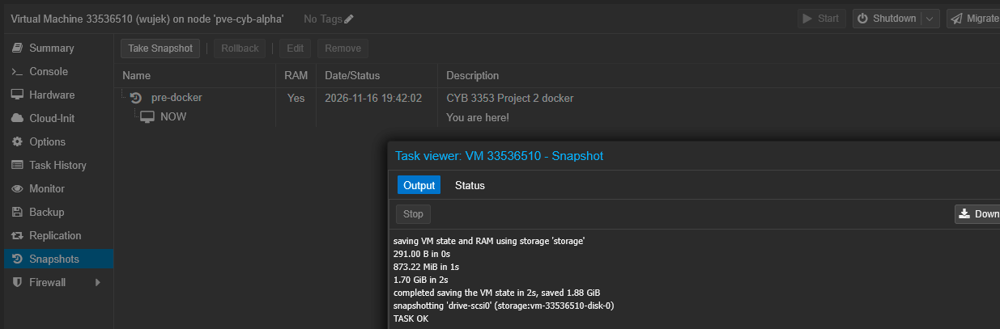

On Ubuntu, I inspected the system:

```bash
cat /etc/os-release       # Identify Ubuntu release
whoami                    # Verify current user
hostname -I               # Display interface IP addresses
nproc                     # Count available CPUs
free -h                   # Show RAM and swap
df -h /                   # Check free space on the root filesystem
```

**Observed:** Ubuntu 24.04.5 LTS (`noble`), 2 logical processors, about 1.9 GiB RAM, and VM IP `10.30.65.10`. The initial root filesystem was approximately 20 GB. My actual disk usage was tracked as the work progressed.

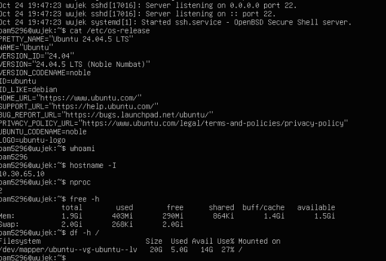


## 2. Docker Engine installation from the official repository

I installed Docker Engine from **Docker's repository**, not the Ubuntu `docker.io` or Snap package, as required by the assignment.

```bash
sudo apt update
sudo apt install -y ca-certificates curl
sudo install -m 0755 -d /etc/apt/keyrings
sudo curl -fsSL https://download.docker.com/linux/ubuntu/gpg \
  -o /etc/apt/keyrings/docker.asc
sudo chmod a+r /etc/apt/keyrings/docker.asc
```

The signing key alone is insufficient: APT also needs the repository definition. I added it in the current Ubuntu `.sources` format:

```bash
sudo tee /etc/apt/sources.list.d/docker.sources > /dev/null <<EOF
Types: deb
URIs: https://download.docker.com/linux/ubuntu
Suites: $(. /etc/os-release && echo "${UBUNTU_CODENAME:-$VERSION_CODENAME}")
Components: stable
Architectures: $(dpkg --print-architecture)
Signed-By: /etc/apt/keyrings/docker.asc
EOF
sudo apt update
apt-cache policy docker-ce
sudo apt install -y docker-ce docker-ce-cli containerd.io \
  docker-buildx-plugin docker-compose-plugin
```

`apt-cache policy` confirmed that an installation candidate was available. I configured the daemon to start at boot and tested it:

```bash
sudo systemctl enable --now docker    # Start now and at boot
systemctl is-enabled docker         # Should print enabled
sudo docker run --rm hello-world     # Test image pull and container execution
docker compose version              # Verify Compose plugin
sudo docker ps                      # Verify daemon access
```

**Result:** `Hello from Docker!` and Docker Compose `v5.7.1` appeared. I used `sudo docker` rather than placing my account in the root-equivalent `docker` group.

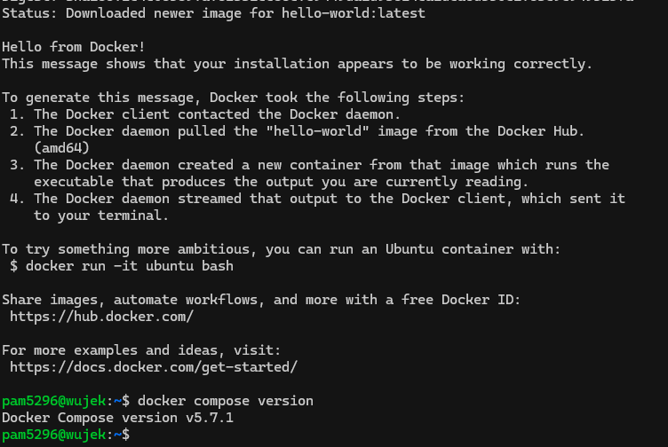

## 3. Uptime Kuma with Docker Compose

I adapted the [official Uptime Kuma Compose example](https://github.com/louislam/uptime-kuma/blob/master/compose.yaml) and created the application directory:

```bash
mkdir -p ~/sysAdmin02/uptime-kuma
cd ~/sysAdmin02/uptime-kuma
nano compose.yaml
```

**Final [`compose.yaml`](compose.yaml) (also included as a separate file):**

```yaml
services:
  uptime-kuma:
    image: louislam/uptime-kuma:2
    restart: unless-stopped
    volumes:
      - ./data:/app/data
    ports:
      - "127.0.0.1:3001:3001"
```

- `image` identifies the Uptime Kuma v2 image, not my project directory.
- `restart: unless-stopped` enables normal automatic recovery after a host restart.
- `./data:/app/data` preserves the SQLite database and configuration outside the container.
- `127.0.0.1:3001:3001` limits dashboard publication to the Ubuntu host's loopback interface. I initially published port 3001 more widely, then restricted it during the security phase.

```bash
sudo docker compose config             # Validate the YAML
sudo docker compose up -d              # Start the application
sudo docker compose ps                 # Check running status and published port
sudo docker compose logs --tail=30     # Investigate startup issues if needed
```

**Result:** The `uptime-kuma-uptime-kuma-1` container reported `Up (healthy)`; the final host port was `127.0.0.1:3001`.

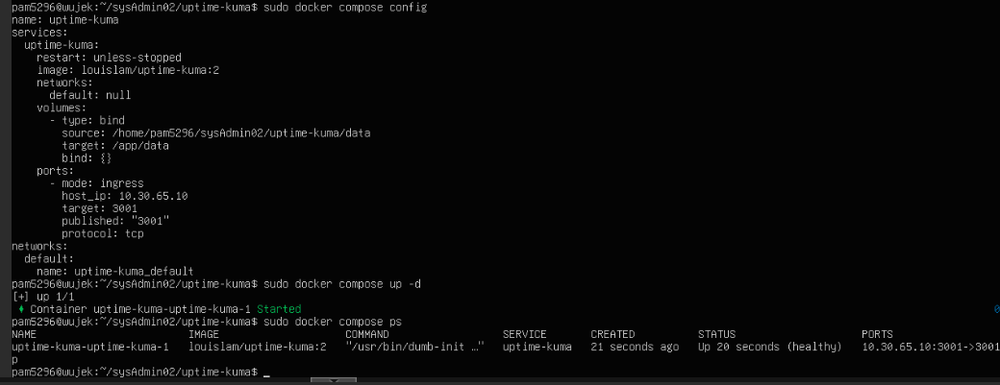

### Access the private dashboard over SSH

From **Windows PowerShell**, not from the VM's Proxmox console:

```powershell
ssh -i "$env:USERPROFILE\.ssh\id_ed25519" -N `
  -L 127.0.0.1:3001:127.0.0.1:3001 pam5296@10.30.65.10
```

Then open `http://127.0.0.1:3001` in the **Windows** browser. The port forward keeps administration traffic inside an SSH connection. I configured a unique Uptime Kuma administrator account and selected **SQLite**, which is suitable for this small single-VM deployment and stores its files under `data/`.

### First service monitor

I added a **TCP Port** monitor with the following settings:

| Setting | Value |
|---|---|
| Name | `wu-SSH` |
| Target | `10.30.65.10` |
| TCP port | `22` |
| Check interval | `60` seconds |

**Result:** The monitor showed **UP**, with approximately 1 ms current response time and 100% uptime across the monitoring history available at the time of the screenshot. This tests TCP port availability, **not SSH login correctness**.

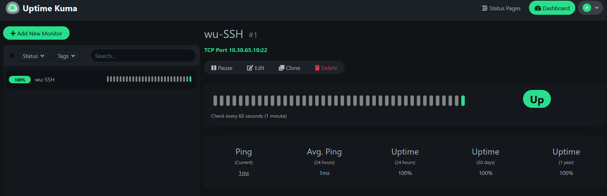

## 4. Verify recovery after a VM reboot

I verified the Docker restart behavior and rebooted only my assigned VM:

```bash
sudo docker inspect uptime-kuma-uptime-kuma-1 \
  --format '{{.HostConfig.RestartPolicy.Name}}'
sudo reboot
```

After reconnecting with SSH, I ran these commands **before** manually starting Compose:

```bash
cd ~/sysAdmin02/uptime-kuma
sudo docker compose ps
```

**Result:** Uptime Kuma was running and healthy again. I reopened the dashboard and confirmed the previously created `wu-SSH` monitor remained available, demonstrating restart persistence and retained application data.

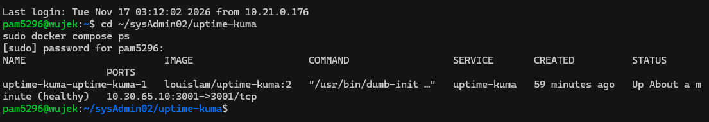

## 5. Harden OpenSSH — key-only login

I reused my existing **** key on Windows, copied its **public** key into Ubuntu's `~/.ssh/authorized_keys`, and verified key-only login in a second Windows terminal. My private key was never copied to the VM.

```powershell
# On Windows, inspect available public keys
Get-ChildItem "$env:USERPROFILE\.ssh" -Filter "*.pub"

# Install the public key on Ubuntu (if not already authorized)
Get-Content "$env:USERPROFILE\.ssh\id_ed25519.pub" |
  ssh pam5296@10.30.65.10 "umask 077; mkdir -p ~/.ssh; cat >> ~/.ssh/authorized_keys; chmod 700 ~/.ssh; chmod 600 ~/.ssh/authorized_keys"

# Confirm public-key authentication without account-password fallback
ssh -v -i "$env:USERPROFILE\.ssh\id_ed25519" `
  -o IdentitiesOnly=yes -o PreferredAuthentications=publickey `
  -o PasswordAuthentication=no -o KbdInteractiveAuthentication=no `
  pam5296@10.30.65.10
```

The SSH debug output explicitly reported **`Authenticated ... using "publickey"`**:

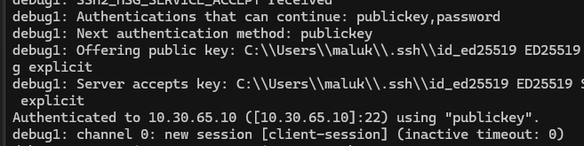

I then created the server-side drop-in configuration `/etc/ssh/sshd_config.d/00-cyber3353-key-only.conf`:

```text
PubkeyAuthentication yes
PasswordAuthentication no
KbdInteractiveAuthentication no
```

```bash
sudo sshd -t               # Validate syntax
sudo sshd -T | grep -Ei '^(pubkeyauthentication|passwordauthentication|kbdinteractiveauthentication) '
sudo systemctl reload ssh  # Apply validated settings
sudo systemctl is-active ssh
```

**Effective configuration:** `pubkeyauthentication yes`, `passwordauthentication no`, and `kbdinteractiveauthentication no`. I kept an existing SSH session open to prevent accidental lockout.

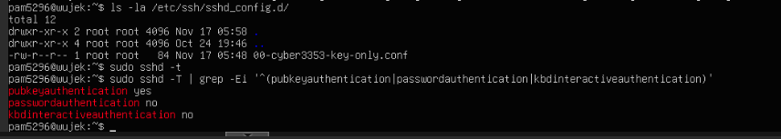

I explicitly tested a password-only connection from Windows:

```powershell
ssh -v -o PubkeyAuthentication=no -o PreferredAuthentications=password `
  -o KbdInteractiveAuthentication=no pam5296@10.30.65.10
```

**Result:** `Permission denied (publickey)`. This was the expected **security success**, showing that a password-only login was refused.

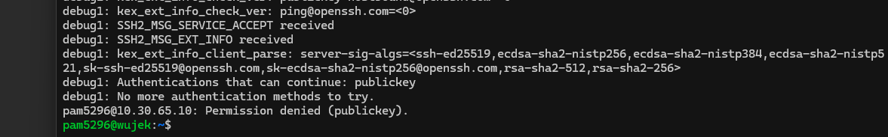

## 6. UFW firewall and private dashboard access

To avoid losing remote access, I allowed SSH **before** enabling UFW:

```bash
sudo ufw allow 22/tcp
sudo ufw default deny incoming
sudo ufw default allow outgoing
sudo ufw enable
sudo ufw status verbose
```

**Observed:** UFW was **active**, logging was on, incoming traffic was denied by default, outgoing traffic was allowed, and TCP 22 was allowed for IPv4 and IPv6.

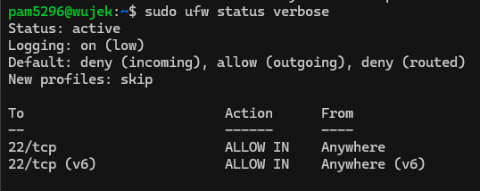

Because Docker-published ports can bypass ordinary UFW filtering, I edited Compose to bind **only** `127.0.0.1:3001`, reapplied it with `sudo docker compose up -d`, and verified the container returned to a healthy state. Access to the dashboard remained possible with the Windows SSH tunnel.

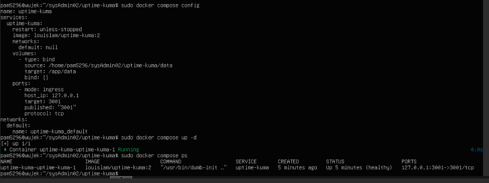

## 7. Automatic Ubuntu security updates

```bash
sudo apt update
sudo apt install -y unattended-upgrades
cat /etc/apt/apt.conf.d/20auto-upgrades
systemctl list-timers 'apt-daily*'
```

The configuration contained:

```text
APT::Periodic::Update-Package-Lists "1";
APT::Periodic::Unattended-Upgrade "1";
```

The two APT timers were scheduled. This verifies **automatic update configuration**, not that a future security update has already installed. Updating Docker images is a separate maintenance responsibility.

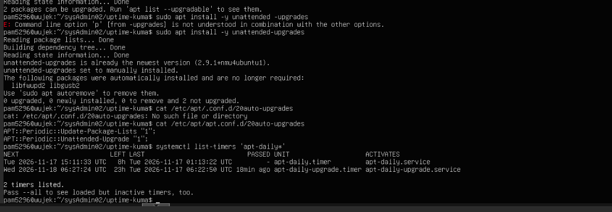

## 8. Uptime Kuma application backup script

The course requires a `tar` script that **stops the application, archives persistent data, restarts it, and keeps only the seven newest archives**. I created a separate backup directory and an executable script:

```bash
mkdir -p ~/sysAdmin02/backups
cd ~/sysAdmin02/uptime-kuma
nano backup.sh
chmod +x backup.sh
bash -n backup.sh   # Bash syntax check
sudo ./backup.sh
```

The following is the documented [`backup.sh`](backup.sh) implementation corresponding to the tested four-stage workflow. **Confirm that the standalone script matches the exact version on your Ubuntu VM before submitting it as the executed file.**

```bash
#!/usr/bin/env bash
set -euo pipefail

APP_DIR="/home/pam5296/sysAdmin02/uptime-kuma"
BACKUP_DIR="/home/pam5296/sysAdmin02/backups"
TIMESTAMP=$(date +%Y%m%d-%H%M%S)
ARCHIVE="$BACKUP_DIR/uptime-kuma-$TIMESTAMP.tar.gz"

mkdir -p "$BACKUP_DIR"
cd "$APP_DIR"
docker compose config --quiet

if [[ ! -d data || -e "$ARCHIVE" ]]; then
    echo "ERROR: Data directory missing or archive already exists."
    exit 1
fi

# Restart the app even if the archive operation fails.
trap 'docker compose start' EXIT

echo "[1/4] Stopping Uptime Kuma..."
docker compose stop

echo "[2/4] Creating backup..."
tar -czf "$ARCHIVE" data
tar -tzf "$ARCHIVE" >/dev/null

echo "[3/4] Restarting Uptime Kuma..."
docker compose start
trap - EXIT

echo "[4/4] Cleaning old backups..."
mapfile -t backups < <(
    find "$BACKUP_DIR" -maxdepth 1 -type f \
        -name 'uptime-kuma-*.tar.gz' -printf '%f\n' | sort -r
)
for ((i=7; i<${#backups[@]}; i++)); do
    rm -- "$BACKUP_DIR/${backups[i]}"
done

echo "Backup completed successfully!"
ls -lh "$ARCHIVE"
```

I executed the script with `sudo` so it could manage Docker and read files owned by root. I confirmed that the backup archive contained the SQLite file `data/kuma.db`:

```bash
sudo ./backup.sh
ls -lht ~/sysAdmin02/backups
sudo docker compose ps
sudo tar -tzf ~/sysAdmin02/backups/uptime-kuma-20261119-050549.tar.gz
```

**Result:** The first backup archive was approximately 117 KB and Uptime Kuma restarted healthy.

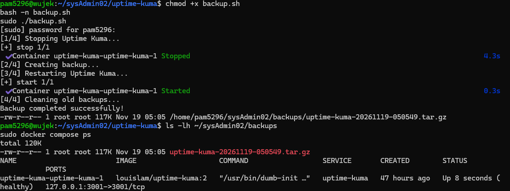

### Seven-archive retention test

The project requires at least two separate backup runs. I executed the script multiple times, then checked the archive directory:

```bash
ls -lht ~/sysAdmin02/backups
find ~/sysAdmin02/backups -maxdepth 1 -type f \
  -name 'uptime-kuma-*.tar.gz' | wc -l
sudo docker compose ps
```

**Result:** Exactly **seven** matching archives remained, the oldest original archive had been removed, and the service was healthy.

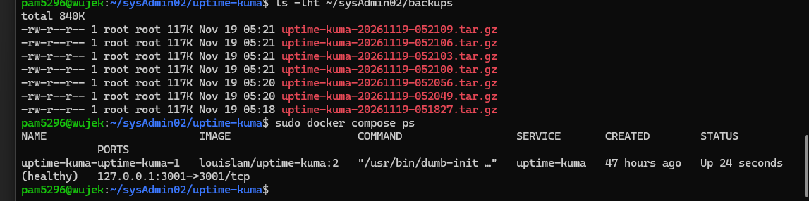

## 9. Restore drill — delete, extract and verify

The project requires an actual recovery demonstration, not just an archive listing. I used the existing `wu-SSH` monitor as my identifiable saved item.

**Before deletion:** The dashboard still displayed `wu-SSH` and its monitoring history.

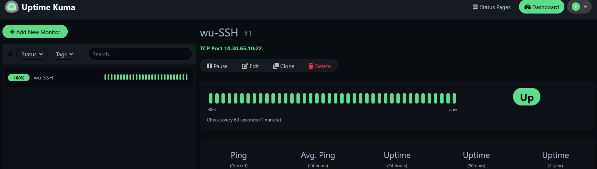

I stopped the container before copying or deleting database files:

```bash
cd ~/sysAdmin02/uptime-kuma
sudo docker compose stop
sudo docker compose ps -a    # Exited (0)
```

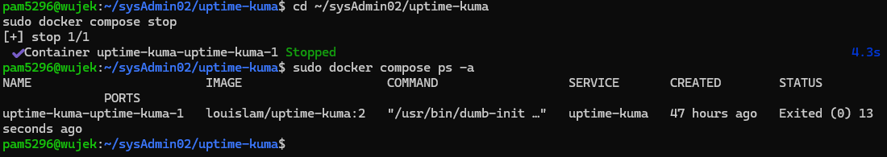

I selected the newest verified archive and created a separately named safety copy **outside** the application's `data/` folder:

```bash
BACKUP=/home/pam5296/sysAdmin02/backups/uptime-kuma-20261119-052109.tar.gz
sudo tar -tzf "$BACKUP"
sudo cp "$BACKUP" ~/sysAdmin02/backups/restore-safety-copy.tar.gz
sudo tar -tzf ~/sysAdmin02/backups/restore-safety-copy.tar.gz
```

Both archive listings included `data/kuma.db` and `data/db-config.json`.

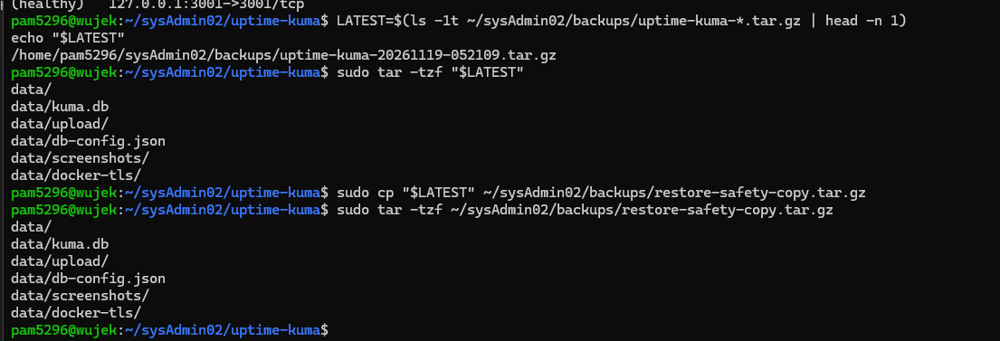

**Deletion and restoration** 

```bash
sudo rm -rf -- /home/pam5296/sysAdmin02/uptime-kuma/data
ls -ld /home/pam5296/sysAdmin02/uptime-kuma/data   # No such file or directory
sudo tar -xzf "$BACKUP" -C /home/pam5296/sysAdmin02/uptime-kuma
sudo ls -lh data/kuma.db
sudo docker compose start
sudo docker compose ps
```

**Result:** The restored `kuma.db` file was present, the existing container restarted healthy, and I could sign in and see the **original `wu-SSH` monitor with its history and UP status**.

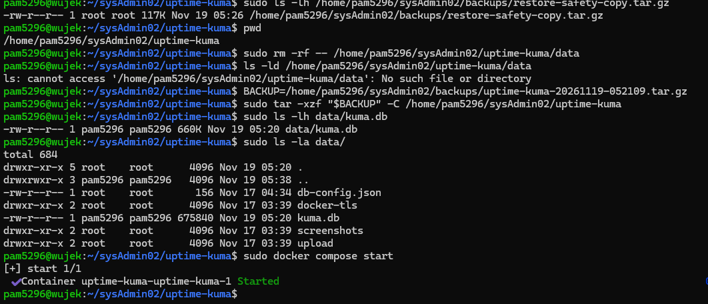

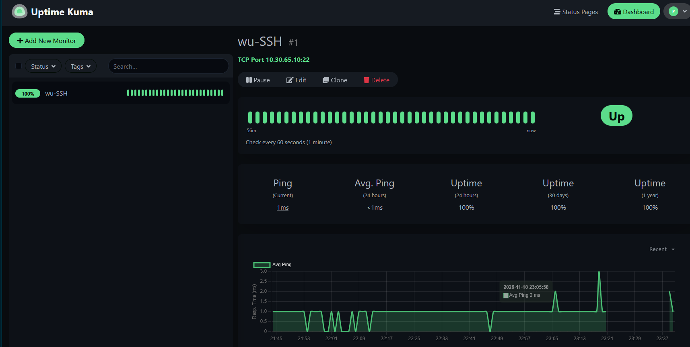

**Recovery conclusion:** The drill demonstrated successful application-level recovery from the backup. Merely listing an archive would not have proven the data was usable.

## 10. Full VM backup in Proxmox

Finally, I backed up the **entire VM**, independently of the Bash application backup:

1. In Proxmox, select VM `33536510 (wujek)` → **Backup → Backup now**.
2. Select storage `backup`, **Snapshot** mode, and ZSTD compression.
3. Run the backup and confirm **`TASK OK`**.
4. Verify the completed `.vma.zst` archive appears in the **Backup** tab.

The job reported `Backup job finished successfully` and `TASK OK`. The backed-up virtual disk was 22 GiB and the resulting archive appeared in storage with a displayed size of approximately 5.06 GB.

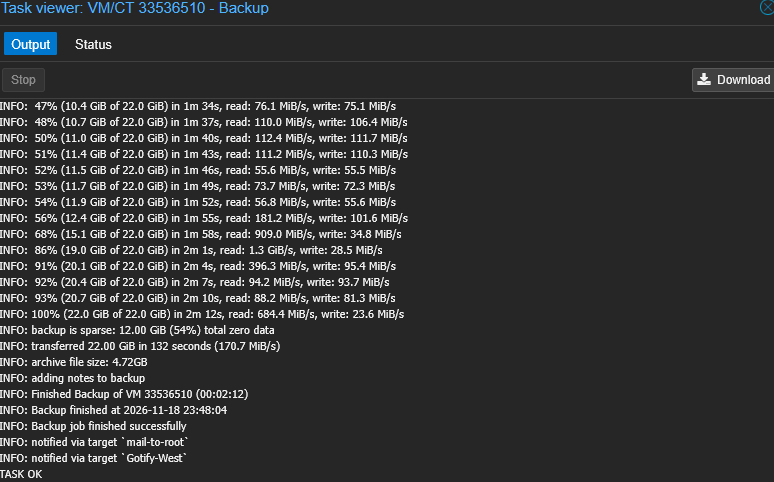

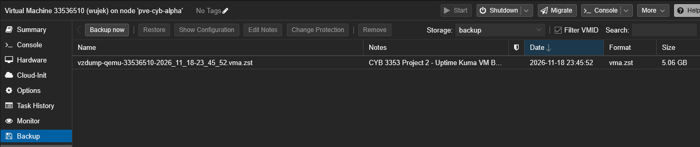

## 11. Troubleshooting and lessons learned

| Issue encountered | Diagnosis and fix |
|---|- |
| SSH tunnel did not open the Windows browser dashboard | Initially issued `ssh -L` **inside Ubuntu**; ran it on Windows PowerShell, where `127.0.0.1` referred to the Windows browser's host. |
|  |
| UFW firewall rules alone did not sufficiently protect the Docker port | Changed the Docker host binding to `127.0.0.1:3001` and used an SSH tunnel. |
| Browser showed a connection error during restore | This was expected because I intentionally stopped Uptime Kuma before deleting and restoring the database. |

### Skills demonstrated

Docker Engine, Compose, Linux server administration, SSH and Ed25519 authentication, TCP port monitoring, port forwarding, firewall policy, unattended updates, Bash scripting, SQLite persistence, archive rotation, recovery validation, and Proxmox snapshots and backups.

## 12. Reproduction command reference

These are the commands used throughout the walkthrough, with a brief explanation for each. Proxmox snapshot and VM backup operations were performed in the web interface.

| Command | What it does |
|---|---|
| `cat /etc/os-release` | Displays the Ubuntu release and codename. |
| `whoami`, `hostname -I`, `nproc` | Identify the account, IP addresses and logical processors. |
| `free -h`, `df -h /` | Show memory and filesystem usage. |
| `sudo apt update` | Refresh available Ubuntu and Docker package lists. |
| `sudo apt install -y ca-certificates curl` | Install trusted certificate and download utilities. |
| `sudo install -m 0755 -d /etc/apt/keyrings` | Create the protected APT signing-key directory. |
| `sudo curl -fsSL ... -o .../docker.asc` | Download Docker's repository signing key. |
| `sudo chmod a+r /etc/apt/keyrings/docker.asc` | Allow APT to read the Docker signing key. |
| `sudo tee .../docker.sources` | Save the official Docker APT repository definition. |
| `apt-cache policy docker-ce` | Check which Docker package version APT can install. |
| `sudo apt install -y docker-ce ...` | Install official Docker Engine, runtime, Buildx and Compose. |
| `sudo systemctl enable --now docker` | Start Docker and enable it at host boot. |
| `sudo docker run --rm hello-world` | Test the Docker Engine by running a disposable container. |
| `docker compose version` | Display the installed Compose plugin version. |
| `mkdir -p`, `cd`, `pwd` | Create, navigate to and identify project directories. |
| `nano compose.yaml` | Create or edit the application stack definition. |
| `sudo docker compose config` | Parse and validate Compose configuration. |
| `sudo docker compose up -d` | Create or update the application in the background. |
| `sudo docker compose ps` | Show Compose container health and port bindings. |
| `sudo docker compose stop`, `start` | Stop or restart the application without removing its persistent data. |
| `ssh -i ... -N -L ...` | Establish an encrypted Windows-to-Ubuntu dashboard tunnel. |
| `ssh -v ...` | Display SSH authentication diagnostics for evidence. |
| `sudo sshd -t`, `sudo sshd -T` | Validate SSH server syntax and inspect effective settings. |
| `sudo systemctl reload ssh` | Apply validated SSH configuration without restarting the host. |
| `sudo ufw allow 22/tcp` | Allow administrator SSH access through UFW. |
| `sudo ufw default deny incoming` | Block other unsolicited inbound traffic by default. |
| `sudo ufw default allow outgoing` | Permit ordinary outbound connections. |
| `sudo ufw enable`, `sudo ufw status verbose` | Enable the firewall and display its effective rule summary. |
| `sudo apt install -y unattended-upgrades` | Install Ubuntu's automatic upgrade tool. |
| `systemctl list-timers 'apt-daily*'` | Inspect APT's scheduled maintenance timers. |
| `chmod +x backup.sh`, `bash -n backup.sh` | Make the backup script executable and syntax-check it. |
| `sudo ./backup.sh` | Stop, archive, restart and rotate Uptime Kuma backups. |
| `tar -czf`, `tar -tzf`, `tar -xzf` | Create, inspect and extract a compressed tar archive. |
| `ls -lht ~/sysAdmin02/backups` | Review backup archive sizes and newest-first order. |
| `rm -rf -- .../data` | Intentionally delete only the application's data during the supervised restore drill. |
| `sudo docker compose logs --tail=50` | Inspect application diagnostics when a service does not become healthy. |


```bash
git add project2-uptime-kuma.md compose.yaml backup.sh assets/project2
git commit -m "Add CYB 3353 Project 2 documentation"
git push
```

`git add` stages only this page and its trimmed evidence; `git commit` records the change; `git push` sends the commit to the repository's configured remote. Link to `project2-uptime-kuma.md` from the existing project index after verifying that the page and every image render correctly.

## Sources

- [Docker — Install Docker Engine on Ubuntu](https://docs.docker.com/engine/install/ubuntu/)
- [Docker Compose documentation](https://docs.docker.com/compose/)
- [Uptime Kuma — official repository and Compose example](https://github.com/louislam/uptime-kuma)
- [Ubuntu — Automatic updates](https://ubuntu.com/server/docs/how-to/software/automatic-updates/)
- [Ubuntu — OpenSSH server](https://ubuntu.com/server/docs/how-to/security/openssh-server/)
- [Ubuntu — Firewalls](https://ubuntu.com/server/docs/how-to/security/firewalls/)
- [Proxmox VE — Backup and Restore (vzdump)](https://pve.proxmox.com/pve-docs/chapter-vzdump.html)


